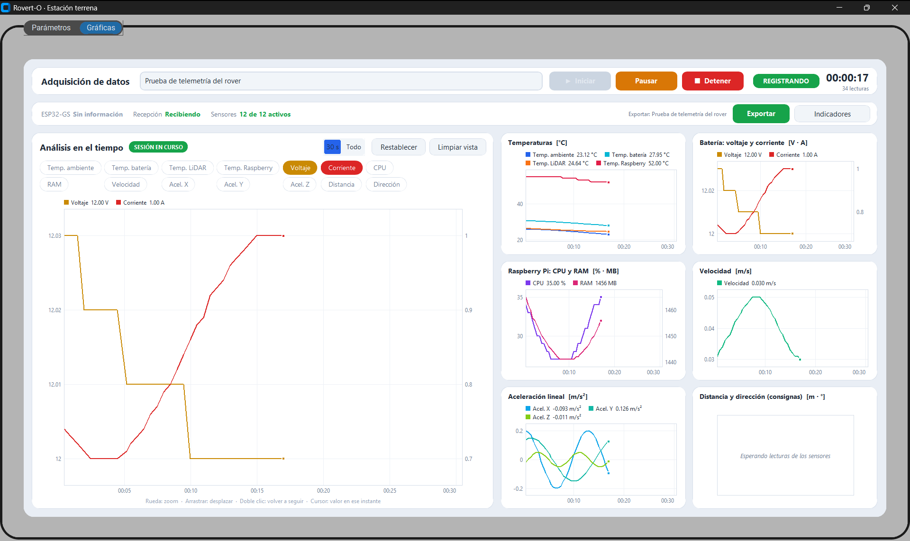
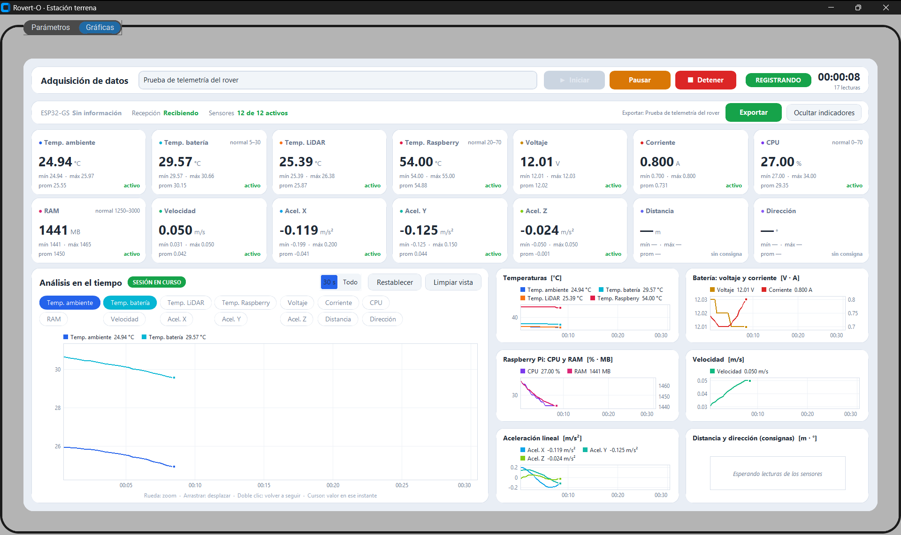
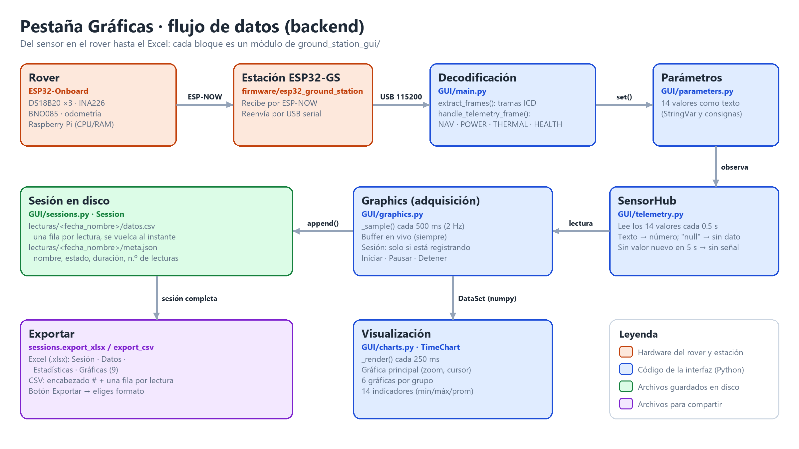
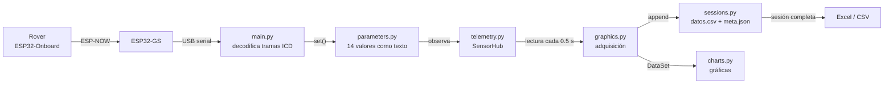
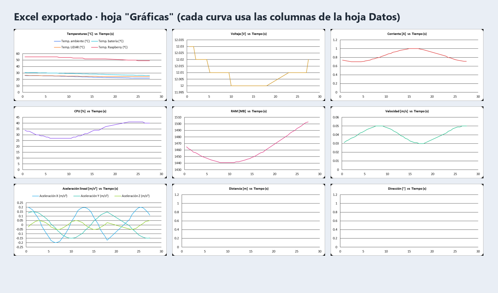

# Guía de la pestaña `Gráficas` (telemetría, sesiones y exportación)

Este documento explica cómo funciona la pestaña **`Gráficas`** de la Estación Terrena: qué datos muestra, cómo se organizan mientras se registran y cómo se exportan a `Excel` o `CSV`. Está pensado para quien vaya a usar la pestaña y para quien vaya a modificar su código.

> **Video de la prueba:** [`media/graficas_prueba.mp4`](media/graficas_prueba.mp4) (1 min). Muestra una sesión completa en modo demo: nombre, iniciar, indicadores, pausar, reanudar, detener y el Excel exportado.



---

## 1. Qué hace la pestaña

* **Muestra en vivo** los 14 datos de la pestaña **`Parámetros`**, con sus mismas unidades.
* **Registra sesiones de medición** con nombre propio. Cada lectura se guarda en disco en el momento en que llega.
* **Exporta** una sesión a `Excel` (`.xlsx`, con gráficas y estadísticas) o a `CSV`.

La pestaña **no recibe datos por su cuenta**: lee lo que ya muestra `Parámetros`. Así, todo lo que llega del rover (o del modo demo) aparece en las gráficas sin código adicional.

---

## 2. Datos disponibles

| Dato | Unidad | Origen (paquete del ICD) | Frecuencia de llegada | Rango normal |
|---|---|---|---|---|
| Temp. ambiente | `°C` | `THERMAL` (`0x04`), sensor de PCB | cada `10 s` | sin definir |
| Temp. batería | `°C` | `THERMAL` (`0x04`) | cada `10 s` | `5` a `30 °C` |
| Temp. LiDAR | `°C` | `THERMAL` (`0x04`) | cada `10 s` | sin definir |
| Temp. Raspberry | `°C` | `HEALTH` (`0x05`) | cada `2 s` | `20` a `70 °C` |
| Voltaje | `V` | `POWER` (`0x03`), INA226 | `1 Hz` | sin definir |
| Corriente | `A` | `POWER` (`0x03`), INA226 | `1 Hz` | sin definir |
| CPU | `%` | `HEALTH` (`0x05`) | cada `2 s` | `0` a `70 %` |
| RAM | `MB` | `HEALTH` (`0x05`) | cada `2 s` | `1250` a `3000 MB` |
| Velocidad | `m/s` | `NAV` (`0x02`), odometría | `10 Hz` | sin definir |
| Aceleración X, Y, Z | `m/s²` | `NAV` (`0x02`), BNO085 | `10 Hz` | sin definir |
| Distancia (consigna) | `m` | Escrita por el operador | al escribirla | — |
| Dirección (consigna) | `°` | Escrita por el operador | al escribirla | — |

* Los **rangos normales** son los de la columna `Normal` de `Parámetros`. Para los que dicen `(min, max)` todavía falta que Electrónica defina el valor.
* La aceleración es **lineal** (`m/s²`), como indica el ICD. No es aceleración angular.
* La "Temp. ambiente" sale del sensor `DS18B20` de la PCB (campo `t_pcb` del paquete `THERMAL`).

---

## 3. Cómo se usa

1. Abre la interfaz y cambia a la pestaña **`Gráficas`**.
   * Sin rover, con datos simulados: `python main.py --demo` desde `ground_station_gui/GUI`.
2. Escribe el **nombre de la sesión** (por ejemplo, `Prueba de temperatura ambiental`). Si lo dejas vacío, se usa la fecha y hora.
3. Presiona **`Iniciar`**. La etiqueta cambia a `REGISTRANDO` y el reloj empieza a contar.
   * `Iniciar misión` en `Parámetros` también inicia una sesión automáticamente.
4. **`Pausar`** detiene el registro sin cerrar la sesión. **`Reanudar`** continúa en la misma sesión. La pausa queda como un hueco en el tiempo, sin lecturas inventadas.
5. **`Detener`** cierra la sesión. La gráfica muestra la sesión completa para revisarla.
6. **`Exportar`** abre el cuadro de guardar: elige `Excel` (por defecto) o `CSV`.

**Otros controles:**

| Control | Qué hace |
|---|---|
| Selectores de variables (chips) | Eligen qué curvas se comparan en la gráfica principal. |
| `30 s` / `Todo` | Ventana de tiempo visible: últimos 30 s o la sesión completa. |
| Rueda del ratón, arrastrar, doble clic | Zoom en el tiempo, desplazar, volver a seguir en vivo. |
| Cursor sobre la gráfica | Muestra el valor de cada curva en ese instante. |
| `Restablecer` / `Limpiar vista` | Quitan el zoom o esconden lo anterior. **No borran datos guardados.** |
| `Indicadores` | Muestra u oculta 14 tarjetas con valor actual, mínimo, máximo, promedio, rango normal y estado. |
| Franja de estado | `ESP32-GS` (conexión USB), `Recepción` (llegan datos) y `Sensores` (cuántos están activos). |



**Estados de un indicador:** `activo` (llegó un valor en los últimos 5 s), `sin señal` (no llega nada nuevo), `sin lectura` (nunca llegó), `fuera de rango` (valor fuera del rango normal) y `sin consigna` (campo vacío).

---

## 4. Cómo funciona por dentro (backend)





### Módulos

| Archivo | Responsabilidad |
|---|---|
| `GUI/main.py` | Lee el puerto serial, separa las tramas del ICD y escribe cada valor en `Parámetros`. También marca `null` los datos vencidos (regla de 3 periodos). |
| `GUI/parameters.py` | Pestaña `Parámetros`: cada dato vive en una variable de texto (`StringVar`). |
| `GUI/telemetry.py` | Lista de los 14 canales (`CHANNELS`: clave, nombre, unidad, color, rango normal) y grupos de gráficas (`GROUPS`). `SensorHub` lee las variables de `Parámetros` y las convierte a números. |
| `GUI/graphics.py` | Pestaña `Gráficas`: controles, ciclo de adquisición, indicadores y exportación. |
| `GUI/charts.py` | Componente de gráfica (`TimeChart`) dibujado sobre `tk.Canvas`, sin librerías externas. |
| `GUI/sessions.py` | Sesiones en disco, recarga, estadísticas y exportación a `CSV` / `Excel`. No depende de la interfaz gráfica, así que se prueba sin abrir la ventana. |

### Dos ciclos independientes

* **Adquisición (`_sample`, cada `500 ms` = `2 Hz`):** toma una lectura de los 14 canales, la agrega al buffer en vivo y, si hay una sesión registrando, la escribe en disco. El periodo es fijo (`PERIOD_MS` en `graphics.py`).
* **Visualización (`_render`, cada `250 ms`):** redibuja indicadores y gráficas, solo si la pestaña está visible y hubo datos nuevos. Si dibujar se volviera lento, espacia los redibujados para no atrasar la adquisición.

### Reglas de los datos

* **"Sin dato" nunca se confunde con cero.** Un valor `null`, vacío o no numérico se guarda como celda vacía, y la curva se corta en ese tramo.
* **No se repiten valores viejos.** Si un sensor no envía nada nuevo en `5 s`, su lectura se registra vacía (`sin señal`). Los sensores térmicos llegan cada `10 s`: `main.py` refresca su valor vigente para que no aparezcan como `sin señal` entre paquetes.
* **Las consignas** (distancia y dirección) se leen del campo que escribe el operador.

---

## 5. Cómo se organizan los datos en disco

Cada sesión tiene su propia carpeta dentro de `ground_station_gui/lecturas/`. Esa carpeta no se sube a GitHub (está en `.gitignore`).

```text
ground_station_gui/lecturas/
├── 20261118_204210_Prueba_de_telemetria_del_rover/
│   ├── meta.json      nombre, estado, inicio, fin, duración, n.º de lecturas, periodo
│   └── datos.csv      una fila por lectura (se escribe y se vuelca a disco al instante)
└── exportados/        carpeta sugerida al exportar
```

* **`datos.csv`** usa las claves internas como encabezado (`t_s, epoch, timestamp, temp_ambiente, …`) y guarda los valores con toda su precisión.
* **`meta.json`** se actualiza al iniciar, pausar, reanudar y detener, y cada 25 lecturas.
* **Si la aplicación se cierra de golpe,** la sesión queda como `interrumpida`, pero se recuperan todas las lecturas escritas. Una última fila a medio escribir se descarta.
* **Una sesión nueva nunca sobrescribe otra,** aunque tenga el mismo nombre y la misma hora.

---

## 6. Exportación

El botón **`Exportar`** exporta la sesión en curso o la última terminada. El nombre sugerido es `<Nombre_de_la_sesión>_<fecha>.xlsx`.

### Excel (`.xlsx`)

| Hoja | Contenido |
|---|---|
| `Sesión` | Nombre, identificador, estado, inicio, fin, duración total, tiempo efectivo (sin pausas), lecturas y periodo. |
| `Datos` | `Timestamp`, `Tiempo (s)` y una columna por dato con su unidad en el encabezado (`Voltaje (V)`, `RAM (MB)`, …). Sin dato = celda vacía. |
| `Estadísticas` | Por dato: lecturas válidas, sin dato, mínimo, máximo, promedio, rango normal y cuántas lecturas salieron de él (fila resaltada si hubo alguna). |
| `Gráficas` | 9 gráficas (una por grupo y unidad) contra el tiempo. Usan las columnas de `Datos`, así que se actualizan si editas los valores. |



### CSV

Las primeras líneas empiezan con `#` y traen la información de la sesión. Después vienen el encabezado y una fila por lectura, con las mismas columnas que la hoja `Datos`. Se guarda en `UTF-8` con BOM para que Excel lea bien los acentos.

---

## 7. Pruebas

```bash
python -m unittest discover -s ground_station_gui/tests
```

Las pruebas cubren pausa y reanudación, sesiones que no se sobrescriben, recarga sin perder precisión, recuperación tras un cierre abrupto, exportación a `CSV` y a `Excel` (incluidas la hoja de gráficas y los rangos normales) y la conversión de texto a número.

Además, se hizo una **prueba de punta a punta** con la interfaz real en modo demo (la del video). En cada lectura se anotó el texto visible en `Parámetros` y luego se comparó con lo exportado:

* Los valores del Excel coinciden celda por celda con lo que mostraba `Parámetros` (350 celdas).
* Cada una de las 14 curvas de las gráficas coincide con su columna del Excel.
* El `CSV` coincide con el Excel.
* La pausa deja un hueco en el tiempo y los promedios de `Estadísticas` coinciden con los indicadores.

---

## 8. Cómo agregar un dato nuevo

1. En `GUI/parameters.py`, agrega la variable que mostrará el dato (por ejemplo, `self.val_presion`).
2. En `GUI/main.py`, escríbela al decodificar su paquete.
3. En `GUI/telemetry.py`:
   * Agrega un `Channel(...)` a `CHANNELS` con clave, nombre, unidad, color y, si aplica, `normal=(min, max)`.
   * Conecta la clave con la variable en `SensorHub.__init__` (diccionario `sources`).
   * Agrégalo a un grupo de `GROUPS` para que tenga gráfica.
4. Corre las pruebas. La columna en el `CSV` / `Excel`, el indicador, el selector y la gráfica aparecen solos.
